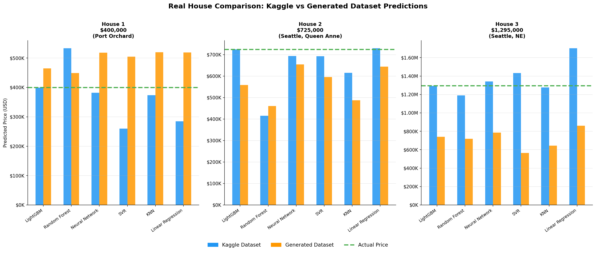
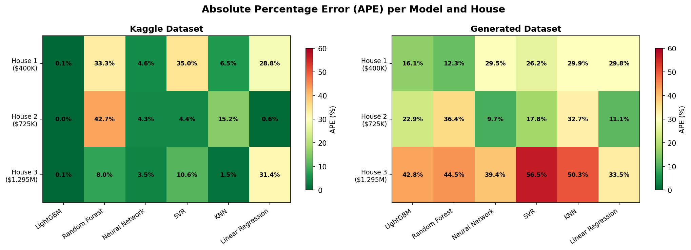
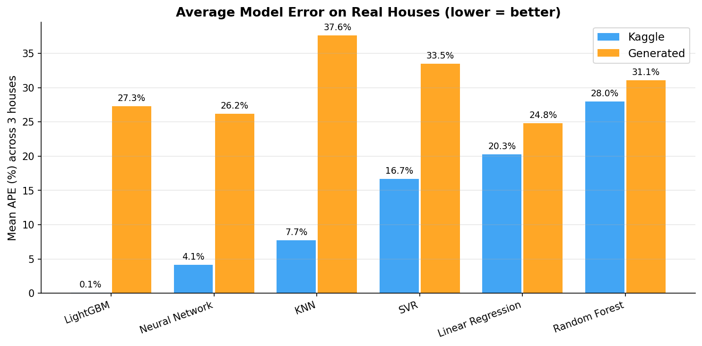

# 1. Problem Description

The **objective** of this project is to predict house sale prices using machine learning regression models.

The **target variable** is the price, which represents the sale price of a house in US dollars.

**Attributes:**
- bedrooms
- bathrooms
- floors
- sqft_living
- sqft_lot
- sqft_above
- sqft_basement
- waterfront
- view
- condition
- grade
- latitude
- longitude
- year built
- year renovated
Engineered features:
- house age, 
- years since renovation
- bath_per_bed

# 2. Datasets
## Kaggle Dataset

The first dataset was obtained from Kaggle (https://www.kaggle.com/datasets/alyelbadry/house-pricing-dataset).

This dataset provides realistic relationships between house characteristics and sale prices.

## Generated Dataset

A second dataset was generated using Claude AI. I asked Claude AI to give me a dataset with the same size as the Kaggle Dataset and approximately the same location (Seattle). He gave me this script (generator.py). This was usefull to compare whether synthetic data could improve model performance.

Although this dataset produced lower validation errors during training, it didn't perform well on real houses. This suggests that the generated data does not fully capture the complexity of the real housing market. Moreover, one of the most important features of a house is its location. However it is hard to artificially reproduce the relation of latitude and longitude to the price of the land.

So this is one big limitation of synthetic datasets. Even though, they may contain simplified patterns that are easier for machine learning models to learn. The good evaluation metrics do not translate into the real-world performance.

# 3. Experimental Setup

## Cross Validation

Instead of performing a single 80/20 train-test split, we use 5-fold cross validation.

In 5-fold cross validation:

The dataset is divided into 5 subsets.
For each iteration:
- 80% of the data is used for training, so 4 folds are used for training.
- 20% is used for testing, so 1 fold is used for testing.
This process is repeated 5 times.
Each sample appears exactly once in the test set and 4 times in the training set.

This provides a more reliable estimate of model performance because the evaluation is not dependent on a single random split.

### The importance of using cross validation:
Using only one 80/20 split may produce misleading results because:

- Performance depends heavily on the chosen split.
- Some slits can have more expensive/affordable houses, making the test biased.
- Outliers may disproportionately affect the results.

Cross validation reduces variance and provides a better estimate of how the model will perform on unseen data.

For example:
Training the Neural Network model one fold produced significantly worse results than the others. So there was a training instability, that was only discovered, when we start doing cross validation, instead of using only one 80/20 split. This problem was solved using a better scaller.

Therefore, cross validation not only improves performance estimation but can also reveal robustness issues in machine learning models.

# 4. Data Preprocessing

## Feature Scaling

This models are sensitive to the scale of the input features.
- Neural Networks
- Support Vector Regression (SVR)
- K-Nearest Neighbors (KNN)

Initially, StandardScaler was used. Howevere, the housing dataset contains several extreme values:
- luxury houses
- very large properties
- unusually expensive homes

These outliers strongly influence the mean and standard deviation.
As a consequence, the Neural Network produced extremely unstable predictions, resulting in errors exceeding 800%, in one fold.

### Solution: Robust Scaling

The scaler was replaced with RobustScaler.

Instead of mean and standard deviation, robust scaling uses median and interquartile range (IQR).
This makes it much less sensitive to outliers and improves numerical stability.
After switching to RobustScaler, the Neural Network produced significantly more reasonable predictions and became trainable.

# 5. Models Evaluated

## Linear Regression

Linear Regression predicts house prices by **modelling a linear relationship** between the input features and the target variable. The model learns a coefficient for each feature and combines them to estimate the final price.
However, the model is **limited to linear relationships**. So it struggles to capture the complexity of housing markets.
According to the learned coefficients, the most influential features were **waterfront**, **latitude**, and **sqft_living**, suggesting that location and proximity to water have a strong linear relationship with house prices.

## Random Forest

Random Forest is an ensemble method that combines the **predictions of multiple decision trees**. Each tree is trained on a random subset of the data, reducing overfitting and improving generalization. 
Feature scaling is not required because trees make decisions using thresholds rather than distances. 
Random Forest is **robust and effective** for modelling nonlinear relationships.
The model assigned most of its importance to **sqft_living**, indicating that house size was the dominant factor used for prediction.

## LightGBM
LightGBM is a gradient boosting algorithm that **builds decision trees sequentially**, with **each tree correcting errors made by previous trees**. Like other tree-based models, it does not require feature scaling because it relies on feature splits rather than distances. 
LightGBM is particularly effective for tabular datasets and achieved the best performance in this study.
The model distributed importance across several variables, with **sqft_living**, **latitude**, **sqft_above**, **longitude**, and **age** being the most influential.

## Support Vector Regression (SVR)

SVR predicts house prices by **finding a function that minimizes prediction errors** while maintaining a smooth model. It can capture nonlinear relationships through kernel functions. **Feature scaling** is necessary because the algorithm relies on distance calculations between observations. SVR can achieve good performance but is **computationally expensive** on larger datasets. Therefore, it makes sense that the **training time was considerably higher** than the other models.
Permutation importance revealed that **sqft_living**, **latitude**, **sqft_above**, and **grade** were the most relevant features for the model's predictions.

## K-Nearest Neighbors (KNN)

KNN predicts the price of a house **based on the prices of the most similar houses** in the training set. Similarity is determined using a distance metric. **Feature scaling** is required because features with larger numerical values would otherwise dominate the distance calculation. KNN is simple and intuitive, but tends to perform worse as the number of features increases.
Feature importance analysis showed that **sqft_living**, **latitude**, and **grade** were among the most influential features.

## Neural Network (MLP)

The Multi-Layer Perceptron (MLP) is a neural network that learns complex nonlinear relationships through **multiple layers of interconnected neurons**. **Feature scaling** is essential, because the training process uses gradient-based optimization, which is sensitive to differences in feature magnitudes. 
The large standard deviation observed across folds suggests that the model is more **sensitive to the specific training data** than tree-based approaches.So RobustScaler produced more stable results than StandardScaler. 
While MLPs are highly flexible, they often require more data and tuning than tree-based methods.
The model relied primarily on **sqft_above**, **sqft_living**, and **sqft_basement**..

## Naive Bayes not used
Naive Bayes was not included, because the problem is a regression task.

# 6. Evaluation Metrics
**Mean Absolute Error (MAE):** Measures the average absolute prediction error.
**Root Mean Squared Error (RMSE):** Measures prediction error while penalizing large mistakes more heavily.
**Coefficient of Determination (R²):** Measures how much variance in house prices is explained by the model. So 1 = perfect prediction, 0 = same as predicting the mean and negative = worse than predicting the mean.
**Mean Absolute Percentage Error (MAPE):** Measures average percentage error.

# 7. Results

### Kaggle Dataset

| Rank | Model             | MAE ($) |    RMSE ($) |        R² |       MAPE |
| ---- | ----------------- | ------: | ----------: | --------: | ---------: |
| 1    | LightGBM          |  64,275 |     118,350 | **0.896** | **11.97%** |
| 2    | Random Forest     |  71,329 |     138,848 |     0.856 |     12.88% |
| 3    | Neural Network    |  83,698 |   843,456   |   -17.508 |     14.96% |
| 4    | SVR               |  86,506 |     225,629 |     0.543 |     15.40% |
| 5    | KNN               |  95,930 |     183,583 |     0.750 |     16.99% |
| 6    | Linear Regression | 113,538 |     227,922 |     0.599 |     20.32% |

### Generated Dataset

| Rank | Model             | MAE ($) | RMSE ($) |        R² |      MAPE |
| ---- | ----------------- | ------: | -------: | --------: | --------: |
| 1    | LightGBM          |  33,290 |   41,653 | **0.826** | **7.39%** |
| 2    | Linear Regression |  33,975 |   42,680 |     0.818 |     7.52% |
| 3    | Neural Network    |  34,091 |   42,744 |     0.817 |     7.57% |
| 4    | Random Forest     |  35,374 |   45,053 |     0.797 |     7.82% |
| 5    | KNN               |  41,505 |   52,602 |     0.723 |     9.16% |
| 6    | SVR               |  42,900 |   54,970 |     0.698 |     9.42% |

### Training Time Comparison

| Model             |  Kaggle | Generated |
| ----------------- | ------: | --------: |
| LightGBM          |   1.1 s |     1.1 s |
| Random Forest     |  23.8 s |    28.2 s |
| Neural Network    |  92.4 s |   108.5 s |
| SVR               | 134.2 s |**899.0 s**|
| KNN               |   0.3 s |     0.3 s |
| Linear Regression |   0.1 s | **0.1 s** |

### Cross-Validation Stability (MAE Standard Deviation)

| Model             |    Kaggle | Generated |
| ----------------- | --------: | --------: |
| LightGBM          | **1,032** |   **281** |
| Random Forest     |     2,463 |       562 |
| Neural Network    |    23,249 |       857 |
| SVR               |     3,111 |       375 |
| KNN               |     4,239 |       177 |
| Linear Regression |     3,435 |       411 |

## Key Observations

| Observation | Evidence |
| ----------- | -------- |     
| Best overall model                       | LightGBM achieved the lowest MAE and highest R² on both datasets.                                                                                              |
| Best traditional model                   | Random Forest was consistently the second-best tree-based model.                                                                                               |
| Neural Network instability               | Large variance between folds and extremely poor RMSE/R² on the Kaggle dataset indicate training instability.                                                   |
| Synthetic data easier to learn           | Every model achieved substantially lower MAE and MAPE on the generated dataset.                                                                                |
| Synthetic data not necessarily realistic | Despite excellent validation scores, performance on real houses was poorer, suggesting that the generated data does not fully represent real market behaviour. |
| Cross-validation was valuable            | One Neural Network fold produced significantly worse results. This issue would likely remain hidden using a single 80/20 split.                                |
| Training cost varies greatly             | LightGBM achieved the best accuracy with training times below 2 seconds, while SVR required up to 899 seconds.                                                 |

## 8. Feature Importance Analysis

| Model             | Top Features                           |
| ----------------- | -------------------------------------- |
| LightGBM          | sqft_living, lat, sqft_above           |
| Random Forest     | sqft_living, lat, grade                |
| Neural Network    | sqft_above, sqft_living, sqft_basement |
| SVR               | sqft_living, lat, sqft_above           |
| KNN               | sqft_living, lat, grade                |
| Linear Regression | waterfront, lat, sqft_living           |

### Common Important Features

| Feature     | Appears in Top Features of |
| ----------- | -------------------------- |
| sqft_living | 6/6 models                 |
| lat         | 5/6 models                 |
| sqft_above  | 4/6 models                 |
| grade       | 3/6 models                 |

**Main conclusion:** House size (`sqft_living`), location (`lat`) and above-ground area (`sqft_above`) were consistently identified as the most relevant predictors of house prices across different machine learning techniques.

Now let me create the matplotlib charts and write up the real house comparison section.Here are the three charts! Now here's the full text you can paste into your report:

---

## 9. Real House Comparison

To evaluate model performance beyond cross-validation, predictions were made on three real houses listed on Zillow in the Seattle area, spanning a wide price range: a modest home at $400,000, a mid-range apartment at $725,000, and a premium property at $1,295,000.

### House 1 — $400,000 (Port Orchard, WA)
https://www.zillow.com/homedetails/1230-Sherman-Ave-Pt-Orchard-WA-98366/23420866_zpid/

| Model | Kaggle | Generated |
|---|---|---|
| LightGBM | $399,446 | $464,477 |
| Random Forest | $533,088 | $449,110 |
| Neural Network | $381,786 | $518,194 |
| SVR | $260,080 | $504,805 |
| KNN | $373,816 | $519,791 |
| Linear Regression | $284,837 | $519,265 |

### House 2 — $725,000 (Queen Anne, Seattle, WA)
https://www.zillow.com/homedetails/1417-Queen-Anne-Ave-N-APT-212-Seattle-WA-98109/462613123_zpid/

| Model | Kaggle | Generated |
|---|---|---|
| LightGBM | $725,058 | $558,824 |
| Linear Regression | $729,553 | $644,181 |
| Neural Network | $694,131 | $654,862 |
| SVR | $692,844 | $596,124 |
| KNN | $615,086 | $488,022 |
| Random Forest | $415,549 | $461,233 |

### House 3 — $1,295,000 (NE Seattle, WA)
https://www.zillow.com/homedetails/1312-NE-70th-St-Seattle-WA-98115/49008441_zpid/

| Model | Kaggle | Generated |
|---|---|---|
| LightGBM | $1,294,348 | $740,885 |
| KNN | $1,275,399 | $643,595 |
| Random Forest | $1,190,814 | $718,813 |
| Neural Network | $1,340,932 | $785,236 |
| SVR | $1,432,416 | $563,913 |
| Linear Regression | $1,701,083 | $861,778 |

Figure 1 — Predicted vs actual price for each model and dataset.

The generated dataset severely underestimated across all models (below $870K, with an error bigger than 33%). The Kaggle models performed well comparatively.

*Figure 2 — Absolute Percentage Error per model and house.*

*Figure 3 — Mean APE across all three houses. LightGBM on the Kaggle dataset achieves by far the lowest real-world error, while generated dataset errors are uniformly higher regardless of model.*

**To sum up** Despite better validation scores, the generated dataset was significantly worse on real houses. The gap is largest at price extremes, confirming that synthetic data oversimplifies real market dynamics.

## 10. Conclusions

This project evaluated six machine learning models for predicting house sale prices using two datasets: a real Kaggle dataset and an AI-generated synthetic dataset.

**LightGBM was the best-performing model by a clear margin**, achieving the lowest MAE and highest R² on cross-validation, and coming remarkably close to the true price on all three real houses. Its speed (under 2 seconds to train), robustness, and accuracy make it the recommended model for this task.

**Tree-based models outperformed distance-based and linear models** in general. Random Forest was consistently second-best on validation metrics. Neural Networks demonstrated potential, but required careful preprocessing (RobustScaler) and were sensitive to training data composition.

**The generated dataset produced misleadingly good validation scores**, but consistently failed on real houses. This confirms a key limitation of synthetic data: it can learn simplified patterns that do not reflect real market behaviour. Location effects (latitude, longitude) are especially difficult to reproduce synthetically.

**Feature importance was consistent across models.** `sqft_living`, `latitude`, and `sqft_above` were the top three predictors across all six models, confirming that house size and location are the dominant factors in Seattle housing prices.

**Cross-validation proved essential**, it exposed Neural Network instability that a single train-test split would have hidden. Moreover, led to the discovery that RobustScaler was necessary for stable training on a dataset with outliers.
